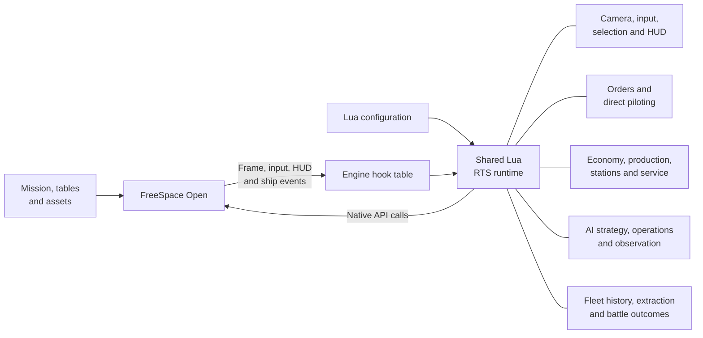
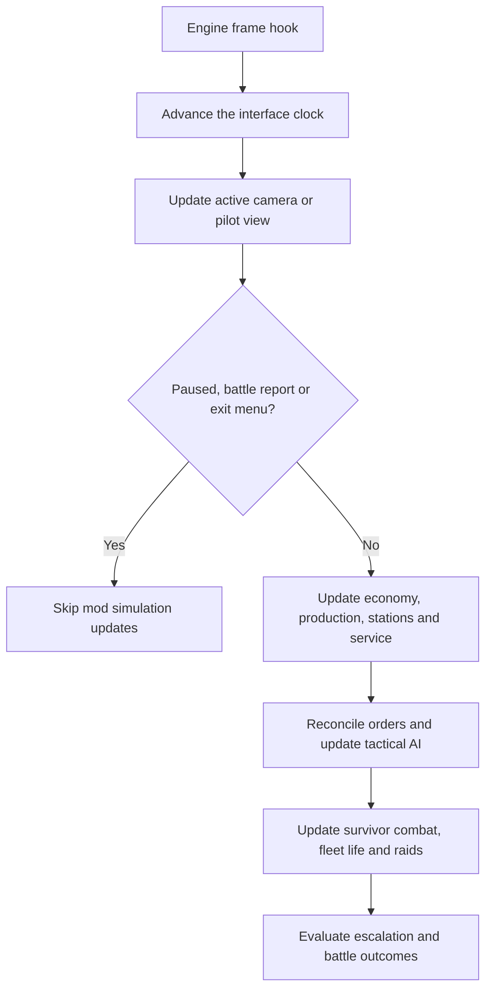

# FreeSpace RTS: Fleet Command

**Command the fleet. Take the cockpit. Bring your survivors home.**

Build a battle group, protect your command station, and fight for control of the battlefield. Then press **P** to take the controls of one of your ships — from a fighter to a capital — before returning to the tactical view.

Fleet Command is a **single-player RTS mod for FreeSpace Open**. Battles grow from station skirmishes into bomber strikes, capital engagements, and desperate withdrawals.

**[Player downloads](https://github.com/BTawaifi/RTS-fleet-command/releases)** · **[Player guide and controls](core/README.md)** · **[Discussion and feedback](https://www.hard-light.net/forums/index.php?topic=100151.0)**

Featured in the **[Hard-Light Highlights](https://www.hard-light.net/forums/index.php?topic=100152.0)**. Visit **[Hard-Light Productions](https://www.hard-light.net/)** for the FreeSpace community, mods, and development.

## Architecture

Fleet Command adds a Lua-driven strategy layer to FreeSpace Open. The engine supplies flight, physics, weapons, and rendering. The mod coordinates fleet commands, production, station development, AI planning, and battle outcomes.

[The Lua entry point](core/data/scripts/fs2rts.lua) loads feature modules that extend a [shared RTS state](core/data/scripts/fs2rts_state.lua). [Engine hooks](core/data/tables/fs2rts-sct.tbm) connect that state to frame updates, input, HUD drawing, combat events, and ship departures. The diagram groups responsibilities within that shared runtime.

| Area | Responsibility | Entry points |
| --- | --- | --- |
| **Engine integration** | Load the Lua runtime and connect native frame, input, HUD, combat, and ship-lifecycle events to mod behavior. | [Hook table](core/data/tables/fs2rts-sct.tbm) |
| **Runtime and lifecycle** | Shared state, scenario setup, frame orchestration, pause handling, restart, and shutdown. Simulation uses mission time; interface updates have a separate clock. | [State](core/data/scripts/fs2rts_state.lua), [lifecycle](core/data/scripts/fs2rts_lifecycle.lua) |
| **Player interface** | Tactical camera, selection, minimap, HUD panels, world overlays, music, and backdrops. | [HUD](core/data/scripts/fs2rts_hud.lua), [input](core/data/scripts/fs2rts_input.lua), [environment](core/data/scripts/fs2rts_environment.lua) |
| **Orders and piloting** | Formation movement, attack and guard commands, control groups, ship possession, capital batteries, and native wing commands. | [Orders](core/data/scripts/fs2rts_orders.lua), [piloting](core/data/scripts/fs2rts_pilot.lua), [player wings](core/data/scripts/fs2rts_player_wing.lua) |
| **Economy and stations** | Faction rosters, command points, production queues, escalation, upgrades, sentries, abilities, and paid repair/rearm. | [Production](core/data/scripts/fs2rts_production.lua), [stations](core/data/scripts/fs2rts_station.lua), [service](core/data/scripts/fs2rts_service.lua) |
| **AI coordination** | Battlefield snapshots feed threat assessment and objective scoring. Operations coordinate multiple wings, while native AI handles immediate flight and combat. Observation and telemetry track execution separately from planned intent. | [Planning](core/data/scripts/fs2rts_ai_planning.lua), [strategy](core/data/scripts/fs2rts_strategy.lua), [operations](core/data/scripts/fs2rts_operations.lua) |
| **Fleet history and outcomes** | Ship histories, losses, crew estimates, citations, extraction, splinter raids, station results, and final fleet outcomes. | [Fleet life](core/data/scripts/fs2rts_fleet_life.lua), [crew records](core/data/scripts/fs2rts_fleet_humanity.lua), [raids](core/data/scripts/fs2rts_traitors.lua) |
| **Content and packaging** | Missions define the scenario; tables define ships, weapons, armor, and factions. Models and textures supply assets, with optional MediaVP compatibility patches and launcher metadata. | [Configuration](core/data/scripts/fs2rts_config.lua), [scenario](core/data/missions/FS2_RTS_Escalation.fs2), [package metadata](mod.json), [MediaVP support](mediavps/README.txt) |

### How the systems work

#### Camera, input, selection and HUD

Mouse and keyboard hooks feed the input layer, which routes actions to camera movement, selection, interface buttons, or fleet commands. Selection and control groups store native ship signatures; the runtime resolves those identifiers back to living ships when an action needs them. World-to-screen projection connects ships in the 3D battle to picking and tactical overlays.

The HUD reads the same runtime state used by gameplay. A selected-ship card can show whether a unit is following your order, under automatic control, or being piloted. The tactical map and world view provide different views of the same fleet. [The HUD modules](core/data/scripts/fs2rts_hud.lua) separate map rendering, selection panels, production controls, and pilot displays.

#### Orders and direct piloting

[The order system](core/data/scripts/fs2rts_orders.lua) records player intent and translates it into native attack, guard, and movement goals. Formation movement assigns ships destinations with hull clearance, then reconciles their progress and final facing. Explicit player orders remove those ships from normal autonomous planning; service and withdrawal have their own control rules.

[Piloting](core/data/scripts/fs2rts_pilot.lua) connects native flight controls and the native HUD to a possessed fleet ship through an observer proxy. The proxy mirrors the ship's position, loadout, shields, energy, and target, while the real fleet hull remains the combat entity. Capital piloting adds turret-group selection, aiming, and manual firing. Returning to the tactical view hands control back according to the ship's current order state.

#### Economy, production, stations and service

Faction configuration supplies rosters and abilities. Production combines configured entries with loaded ship properties to build the purchase catalog. Command points fund queued construction, station upgrades, defensive platforms, and fleet service. Production checks budget, unlocks, and fleet capacity before progressing jobs and creating native ships.

[Station service](core/data/scripts/fs2rts_service.lua) coordinates an actual round trip: reserve a pad, route the ship to it, wait for arrival and capacity, then spend command points on hull, subsystem, and ammunition recovery. A damaged bomber can retain its previous assignment while undergoing service; completion restores that assignment. A fresh player command cancels service and releases the ship for its new task. Travel time never accumulates repair credit.

#### AI strategy, operations and observation

[AI planning](core/data/scripts/fs2rts_ai_planning.lua) builds a battlefield context containing ships, factions, positions, hull condition, weapons, and current targets. Spatial queries reuse that context to find nearby threats and support. Objective scoring evaluates possible tasks for groups, and commitment rules decide whether to keep an existing assignment or issue another.

[Operations](core/data/scripts/fs2rts_operations.lua) coordinate multiple wings around shared objectives, including assembly, screening, and strikes. Native AI executes immediate flight and combat. [Execution observation](core/data/scripts/fs2rts_ai_planning/observation.lua) checks native goals and target acquisition, while combat hooks record hits. These observations allow decision telemetry to distinguish what the planner requested from what ships actually did.

#### Fleet history, extraction and battle outcomes

[Fleet records](core/data/scripts/fs2rts_fleet_life.lua) follow ships through commissioning, piloting, service, combat, loss, and departure. CREWS and battle reports use these match-local records; crew and casualty estimates are derived from configured models and labeled as estimates. Ship deaths and departures also clear references held by selection, orders, and other systems.

[Losing a station and resolving the battle](core/data/scripts/fs2rts_lifecycle.lua) are separate transitions. The global station result stops further economy and construction, while surviving fleets can continue fighting or extracting. Extraction routes ships toward departure areas and requests native warp-out. A ship is recorded as escaped only when the engine reports its departure, so reaching an exit waypoint alone does not count as survival.

### Runtime flow

During normal gameplay, [the frame loop](core/data/scripts/fs2rts_lifecycle.lua) updates the active view before checking whether mod simulation updates should proceed. Input and HUD drawing also have their own engine hooks. The simplified flow below shows the main update sequence; individual systems apply their own scenario and lifecycle checks.

Player commands, direct piloting, autonomous planning, station service, and withdrawal all interact with the same native ships. Their control rules coordinate those transitions. Death and departure hooks update fleet records, while station resolution and the final fate of surviving ships remain separate outcomes.

## Choose your battle

- **Nine faction identities, 2–12 teams.** Field GTA, GTVA, PVN, Vasudan Empire, NTF, loyal or rogue GTI, Hammer of Light, or Shivan fleets. Choose each team's faction and color, with Circle, Star, and Multiple Circles starting layouts.
- **Command from above, fight from within.** Give attack, guard, formation, and withdrawal orders. Pilot friendly ships with native flight controls; capitals add selectable turret batteries and manual guns and beams.
- **Build a station worth defending.** Invest in Armor, Defenses, Logistics, and Command. Place sentries, unlock faction abilities, and bring damaged ships back for paid repair and rearm.
- **Keep track of the ships you fought beside.** CREWS records this battle's flown ships, losses, escapes, and citations. Optional crew and casualty estimates stay hidden until you press F9.
- **Fight beyond the loss of your station.** Withdraw your surviving fleet or continue the battle. Station outcomes and the final fate of your mobile forces are recorded separately.
- **Set the pace and the scene.** Pause to issue orders, adjust time compression, pick music and a sky backdrop, or let the battle director follow the action. Rare announced splinter raids introduce new hostile ships.

Fleet Command is under active development. Balance and performance are still being tested, especially in large late-game fleets, twelve-team battles, and high time compression. Feedback and bug reports are welcome in the [discussion thread](https://www.hard-light.net/forums/index.php?topic=100151.0).

## Get into the battle

You need **retail FreeSpace 2 assets** and **FreeSpace Open**. MediaVPs are optional.

Follow the [player guide](core/README.md) to install and launch the mod. Choose your teams, click **START ESCALATION**, and build your fleet. The guide also covers controls, optional MediaVP loading, station service, and piloting.

## Contributing

Want to extend Fleet Command? [Open an issue](https://github.com/BTawaifi/RTS-fleet-command/issues) to discuss an idea or report a bug, or [submit a pull request](https://github.com/BTawaifi/RTS-fleet-command/pulls) with your changes.

Describe what the change does, why it is needed, and how you tested it. For gameplay bugs, include the FSO build, factions, team count, and steps to reproduce.

## Credits

Created by Boutros. Third-party assets retain their owners' terms; see [asset credits](core/data/ASSET-CREDITS.txt), [FSPort credits](core/data/FSPORT-ASSET-CREDITS.txt), and [insignia credits](core/data/maps/README-insignias.txt).
