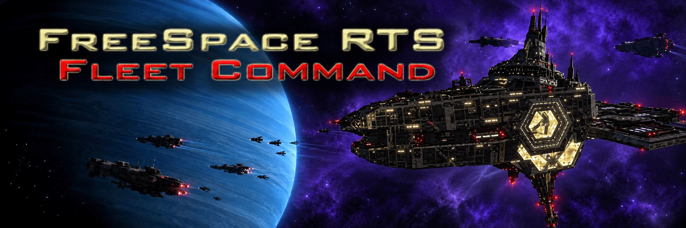

# FreeSpace RTS: Fleet Command

**Command the fleet. Take the cockpit. Bring your survivors home.**

Build a battle group, protect your command station, and fight for control of the battlefield. Then press **P** to take the controls of one of your ships — from a fighter to a capital — before returning to the tactical view.

Fleet Command is a **single-player RTS mod for FreeSpace Open**. Battles grow from station skirmishes into bomber strikes, capital engagements, and desperate withdrawals.

**[Player downloads](https://github.com/BTawaifi/RTS-fleet-command/releases)** · **[Player guide and controls](core/README.md)** · **[Discussion and feedback](https://www.hard-light.net/forums/index.php?topic=100151.0)**

Featured in the **[Hard-Light Highlights](https://www.hard-light.net/forums/index.php?topic=100152.0)**. Visit **[Hard-Light Productions](https://www.hard-light.net/)** for the FreeSpace community, mods, and development.

## Choose your battle

- **Nine faction identities, 2–12 teams.** Field GTA, GTVA, PVN, Vasudan Empire, NTF, loyal or rogue GTI, Hammer of Light, or Shivan fleets. Choose each team's faction and color, with Circle, Star, and Multiple Circles starting layouts.
- **Command from above, fight from within.** Give attack, guard, formation, and withdrawal orders. Pilot friendly ships with native flight controls; capitals add selectable turret batteries and manual guns and beams.
- **Build a station worth defending.** Invest in Armor, Defenses, Logistics, and Command. Place sentries, unlock faction abilities, and bring damaged ships back for paid repair and rearm.
- **Keep track of the ships you fought beside.** CREWS records this battle's flown ships, losses, escapes, and citations. Optional crew and casualty estimates stay hidden until you press F9.
- **Fight beyond the loss of your station.** Withdraw your surviving fleet or continue the battle. Station outcomes and the final fate of your mobile forces are recorded separately.
- **Set the pace and the scene.** Pause to issue orders, adjust time compression, pick music and a sky backdrop, or let the battle director follow the action. Rare announced splinter raids introduce new hostile ships.

Fleet Command is under active development. Balance and performance are still being tested, especially in large late-game fleets, twelve-team battles, and high time compression. Feedback and bug reports are welcome in the [discussion thread](https://www.hard-light.net/forums/index.php?topic=100151.0).

## Get into the battle

You need **retail FreeSpace 2 assets** and **FreeSpace Open**. MediaVPs are optional.

Follow the [player guide](core/README.md) to install and launch the mod. Choose your teams, click **START ESCALATION**, and build your fleet. The guide also covers controls, optional MediaVP loading, station service, and piloting.

## Credits and license

Created by Boutros. Original mod code, missions, and table definitions use the [MIT license](LICENSE). Third-party assets retain their owners' terms; see [asset credits](core/data/ASSET-CREDITS.txt), [FSPort credits](core/data/FSPORT-ASSET-CREDITS.txt), and [insignia credits](core/data/maps/README-insignias.txt).
